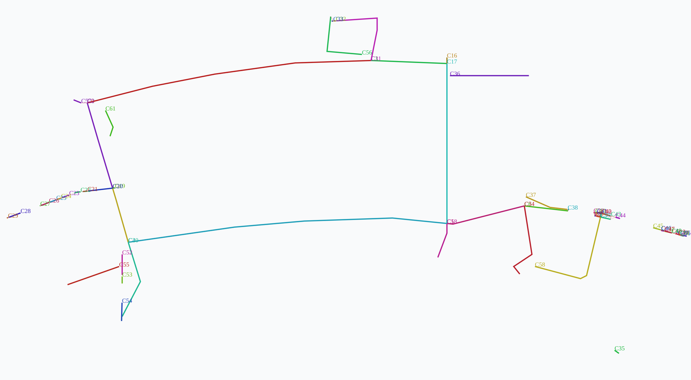

# Navigation V2 benchmark and status

## Status

The V2 result is an incomplete diagnostic candidate. It is not the runtime graph, and it does not satisfy the 54-approach connectivity acceptance criterion. The current canonical GF graph remains active. No source-derived SVG screenshot of a complete V2 route comparison is available yet. The component diagnostic SVG is shown below and is not a route visualization.



The SVG labels disconnected geometry components. Green/red candidate strokes indicate geometric validation outcome in the diagnostic script, not an approval decision. Treat it as the preliminary endpoint-pair diagnostic; the current strict graph counts below come from the latest reconstruction and verifier artifacts.

## Counts from checked-in generated reports

| Measure | Legacy reference | Current V2 diagnostic | Interpretation |
| --- | ---: | ---: | --- |
| Nodes | 428 | 172 | The smaller output reflects severe fragmentation, not successful simplification. |
| Edges | 627 | 57 | Candidate output graph contains 46 of 54 expected approach node IDs. |
| Directory approaches | 54 | 46 node IDs present; 8 missing | The strict graph verifier identifies missing IDs for G-06, G-17, G-19, G-20, G-21, G-28, G-39, and G-40. |
| Connected components | n/a | 115 | Largest component has 14 nodes and only 4 room approaches. |
| Raw corridor components | n/a | 31 | Configured spine network before clipping. |
| Clipped/noded components | n/a | 62 | Components after clipping/union operations, before candidate joining. |
| Safe endpoint candidates | n/a | 175 | Direct candidate segments pass the current strict walkable/wall predicate. |
| Selected component links | n/a | 104 | The strict reconstruction retained candidate links; only one serialized edge was rejected. |
| Strict walkable-area edge failures | n/a | 0 of 57 | Acceptance uses exact `domain.covers(edgeLine)` against the unbuffered navigable-area union. |
| Wall contacts | n/a | 0 | No supplied wall intersections were found by the verifier. |
| Room-interior crossings | n/a | 0 | No tested edge crossed the verifier's room obstacles. |
| Route length, turns, clearance | Not measured in this artifact set | Not measured | Must be calculated on comparable validated routes before making quality claims. |
| Generation time / Dijkstra performance | Not recorded | Not recorded | No benchmark timing is currently available. |

Legacy counts above are the baseline stated in the Navigation V2 task/audit (428 nodes, 627 edges). Current candidate counts are from the latest `artifacts/navigation-v2/reconstruction-report.json` and `candidate-validation.json`. The graph is fragmented into 115 components, and the largest contains only 4 approaches. The lower node/edge count signals lost or rejected connections, not improved topology. Route lengths and route quality remain unmeasured.

## Geometry safety and unresolved report

An earlier buffered diagnostic counted room-link records before strict serialization and overstated attachment. The latest strict graph-level verifier confirms only 46 of 54 expected approach node IDs exist. The missing list is G-06, G-17, G-19, G-20, G-21, G-28, G-39, and G-40. G-39 and G-40 remain unresolved connector searches; the other six are also absent from the emitted graph.

The strict verifier reports 115 graph components. The largest has 14 nodes and 4 approaches. Only 46 approach IDs exist in the graph, and those are split among many disconnected components.

The latest `candidate-validation.json` reports zero edges failing exact `domain.covers` against the unbuffered walkable-area union, zero wall contacts, and zero room-interior crossings. Geometry safety passes these three checks, but overall acceptance is **FAIL** because the graph has 115 components and eight approach IDs are missing. Strict mode rejects many near-miss joins that the buffered generator mode had accepted, which explains much of the fragmentation. The G-39/G-40 connector search failures remain:

| Room | Approach coordinate | Result |
| --- | --- | --- |
| G-39 | `[926.4935, 1431.457]` | No direct or bounded local-A* connector passed walkable coverage and wall clearance. |
| G-40 | `[926.4935, 1431.457]` | Same unresolved connector result; shared coordinate is not proof of a passage. |

The detailed endpoint-pair evidence is in `connectivity-diagnostics.json`; component rendering is in `spine-components.svg`. These diagnostics do not establish valid complete routes.

## Reproduction and tests

Run the generator commands listed in [developer-guide](developer-guide.md), then run the strict verifier:

```powershell
.venv\Scripts\python.exe -X utf8 scripts/semantic-map/verify_centerline_candidate.py
```

The verifier writes `artifacts/navigation-v2/candidate-validation.json` and prints the same result. Latest results: 172 nodes, 57 edges, 115 components, 46/54 approach IDs present, 4 approaches in the largest component, zero exact-domain failures, zero wall contacts, zero room-interior crossings, and acceptance `FAIL`. The reconstruction report records 62 clipped spine components, 175 safe direct join candidates, 104 selected candidate links, and one rejected serialized edge. No route-length, turn-count, minimum-clearance, generation-time, or routing-performance comparison has been produced.

This documentation update did not run browser or e2e tests. The earlier branch baseline reported four failures in `visual-corners.qa.test.ts` around accepted smoothing radii above 12; compare those against the baseline before changing any assertion. This document does not claim those failures were fixed or retested.

## Limitations and next evidence needed

- Resolve the precise source geometry near G-39/G-40, or keep them explicitly unresolved.
- Review each selected connector and retained alternative against the source drawing; geometric containment alone does not prove a physical connection.
- Validate all candidate routes with existing route safety checks and compare the same OD pairs against legacy for length, turns, and clearance.
- Record deterministic regeneration checks and bounded preprocessing timings.
- Render source-based side-by-side legacy/V2 graphs and routes only after candidate connectivity is complete.
- Keep the canonical runtime graph and routing policies unchanged until these checks pass.
